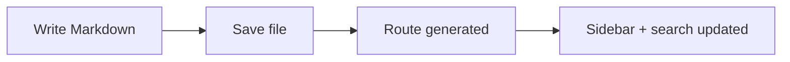

# Writing Notes

## File naming

The file path decides the route, so name files the way you usernamet to read them in
a URL: lowercase, words separated by hyphens.

```text
content/git/git-submodules.md   ->  /git/git-submodules
linux/ubuntu/static-ip.md       ->  /linux/ubuntu/static-ip
```

The first directory is the category. Nested directories become collapsible
groups inside that category in the sidebar.

> [!IMPORTANT]
> A note must live inside a directory. Markdown files at the top level of the
> repository, such as `README.md`, are intentionally not published.

## Frontmatter reference

Every field is optional. Anything you leave out is inferred from the file.

```yaml
---
title: "Useful Git Commands"
description: "A collection of useful Git commands for everyday development."
category: "Git"
tags:
  - git
  - github
  - commands
date: "2026-08-12"
updated: "2026-08-12"
published: true
featured: true
author: "Sai"
readingTime: 6
---
```

| Field | Type | Default when missing |
| --- | --- | --- |
| `title` | string | The first `#` heading, otherwise the file name |
| `description` | string | The first paragraph, otherwise the section headings |
| `category` | string | The directory name, title-cased |
| `tags` | list of strings | Empty |
| `date` | date | The file creation time |
| `updated` | date | `date`, otherwise the file modification time |
| `published` | boolean | `true` |
| `featured` | boolean | `false` |
| `author` | string | Not shown |
| `readingTime` | number (minutes) | Calculated from the word count |

Unknown fields are rejected on purpose, so a typo such as `titel` fails loudly
instead of silently disappearing:

```text
Invalid frontmatter in:

  content/git/example.md

  • unknown field: titel
```

Run the checker at any time:

```bash
npm run content:check
```

## Supported Markdown

Standard CommonMark plus GitHub Flavoured Markdown: tables, task lists,
strikethrough and autolinks.

### Alerts

```markdown
> [!WARNING]
> This rewrites history on the remote.
```

> [!WARNING]
> This rewrites history on the remote.

Supported types are `NOTE`, `TIP`, `IMPORTANT`, `WARNING` and `CAUTION`.

### Code blocks

Add a language for accurate highlighting. Every block gets a language label and
a copy button.

```python
from pathlib import Path

for path in Path("content").rglob("*.md"):
    print(path)
```

### Diagrams

Fenced `mermaid` blocks are rendered as diagrams in the browser.



### Linking between notes

Relative links to other Markdown files are rewritten to real routes, so links
keep working both on the site and in your editor.

```markdown
See [the welcome note](./welcome.md) or [Git submodules](../git/git-submodules.md).
```

See [the welcome note](./welcome.md) for the short version.

## Drafts

Set `published: false` to keep a note out of the site, the sidebar, the search
index and the sitemap while you work on it.
