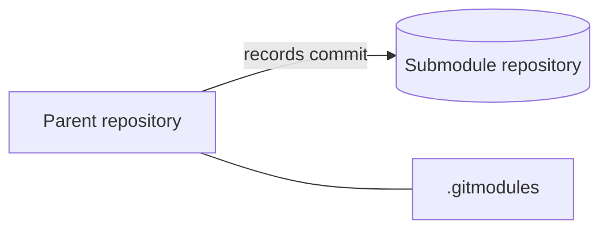

# Git Submodules

A submodule is a pointer to a specific commit in another repository. The parent
repository stores the URL and the commit, never the files themselves.



## Add a submodule

```bash
git submodule add https://github.com/user/library.git vendor/library
git commit -m "chore: add library submodule"
```

Two things are committed: the `.gitmodules` file and a special entry for
`vendor/library` that stores the commit SHA.

## Clone a repository that has submodules

```bash
# Everything in one step
git clone --recurse-submodules https://github.com/user/project.git

# Or, after a plain clone
git submodule update --init --recursive
```

> [!TIP]
> Set `git config --global submodule.recurse true` and pulls, checkouts and
> clones will handle submodules for you.

## Update a submodule

```bash
# Move a submodule to the latest commit on its default branch
git submodule update --remote vendor/library

# The parent repository must record the new commit
git add vendor/library
git commit -m "chore: bump library submodule"
```

## Work inside a submodule

A fresh submodule checkout is in a detached HEAD state, so commit on a branch:

```bash
cd vendor/library
git switch main
git pull
# make changes, commit, push
cd ../..
git add vendor/library
git commit -m "chore: update library submodule"
```

## Remove a submodule

```bash
git submodule deinit -f vendor/library
git rm -f vendor/library
rm -rf .git/modules/vendor/library
git commit -m "chore: remove library submodule"
```

> [!CAUTION]
> `rm -rf .git/modules/...` deletes the submodule's local history. Make sure
> anything you care about has been pushed first.

## Useful commands

| Command | What it does |
| --- | --- |
| `git submodule status` | Lists submodules with their recorded commits |
| `git submodule summary` | Shows commits added or removed since the last record |
| `git submodule foreach 'git status'` | Runs a command in every submodule |
| `git submodule sync` | Applies changed URLs from `.gitmodules` |
| `git diff --submodule` | Shows submodule changes as commit lists |

## Troubleshooting

### The submodule directory is empty

The pointer was cloned but the contents were not:

```bash
git submodule update --init --recursive
```

### "modified: vendor/library (new commits)"

The submodule is on a different commit than the one recorded. Either record the
new commit, or go back to the recorded one:

```bash
git add vendor/library                       # accept the new commit
git submodule update --checkout vendor/library  # discard it
```

### The URL changed

```bash
git config --file=.gitmodules submodule.vendor/library.url https://new/url.git
git submodule sync
git submodule update --init --recursive
```

> [!NOTE]
> If a submodule is only there to pin a dependency, a package manager or
> `git subtree` is often easier for the rest of the team to live with.
